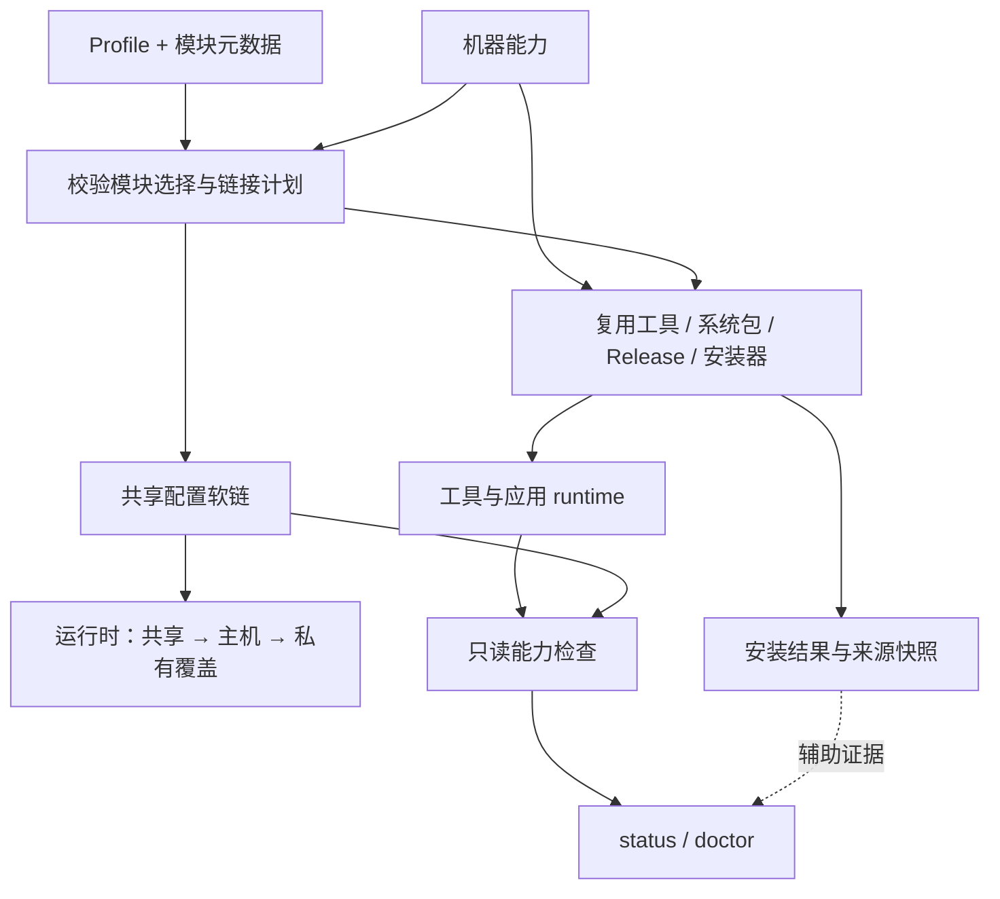

# envup

> 用一个仓库和一个 CLI 管理一致的终端开发环境。

[](https://github.com/gendu-amd/envup/actions/workflows/ci.yml)
[](LICENSE)


[English](README.md) | **简体中文**

envup 将 shell、编辑器、tmux 和常用 CLI 拆成独立模块统一安装。它既适合
workstation，也适合无 root、代理、离线或共享 HOME 的服务器：已有配置先备份，
工具或组件缺口明确报告，身份、历史、会话和项目工具链由用户保管。
仓库更新、系统包和第三方安装器各有恢复边界。

## 环境要求

- Bash 4.0 或更高。macOS 先执行 `brew install bash`，envup 会自动找到新版 Bash。
- Git 2.0 或更高。
- macOS、Linux、WSL2 或 Docker。

root、包管理器和网络都不是硬要求；缺少时仍会落好配置，并尽量安装兼容的用户态
release。

## 快速开始

本文描述当前 checkout，包含 CHANGELOG 中的 Unreleased 变化。当前历史是没有
发布 tag 的初始基线，直接克隆 `main` 即可使用。

```bash
git clone --recursive https://github.com/gendu-amd/envup.git
cd envup
./envup install --dry-run       # 先查看默认 standard 的安装计划
./envup install                 # 默认 standard profile
# ./envup install --profile full
# ./envup install nvim tmux     # 只装指定模块
./envup status
./envup doctor
exec zsh                       # 确认 zsh 可用后再进入
```

如果 clone 时漏了子模块：

```bash
git submodule update --init --recursive
```

仓库内使用 `./envup`；安装 zsh 模块后可以在任意目录直接运行 `envup`。
Git 姓名和邮箱放在 `~/.gitconfig.local`，具体命令见下例。保留其它 shell 时，
可以只装工具，将报告的二进制目录加入 PATH，并自行配置对应 shell 集成。

### 部署与功能验收

人工或 agent 部署都按这个顺序执行：

1. 确认目标主机／容器、支持的平台、可写安装目录及 HOME 是否共享，选择 profile 和必需语言。
2. 预览所选配置、执行安装，再打开新终端，让 PATH 和 shell 集成生效。
3. 运行 `envup status` 和 `envup doctor`。补齐必需能力；可选能力的 `degraded`／`skipped`
   结果单独报告，不标成全部完成。
4. 按下表验收所选工作流。模块健康检查不能替代交互检查；无法执行的平台或终端检查明确列出。

| 所选能力 | 功能检查 |
|---|---|
| Shell 与导航 | 在新 shell 中使用 `z`、`Ctrl-r`、`Ctrl-t`。 |
| Git | 确认身份及私有覆盖，在仓库中查看 `git diff`。 |
| tmux | 创建 pane、复制到本地终端，用临时 session 验证保存与恢复。 |
| Nvim | 打开、编辑、保存临时文件；对所选语言检查定义跳转、诊断和项目启用的格式化。 |
| Docker 构建 + Host clangd | 使用一致的绝对路径，或运行 `envup clangd sync`；重启 LSP 后验证实际项目定义跳转。 |

剪贴板需要实际的外层终端验收；语言导航需要项目工具链、头文件和编译数据库。
安装命令成功本身不能证明这些条件已经满足。

### 从首次安装到撤销

先只安装 Git，观察配置生命周期，无需切换 shell。以下命令在有 tracking branch
的 checkout 内执行：

```bash
./envup install git --dry-run
./envup install git
git config --file "$HOME/.gitconfig.local" user.name "Your Name"
git config --file "$HOME/.gitconfig.local" user.email "you@example.com"
git config --file "$HOME/.gitconfig.local" alias.st "status --short"
git config --global --includes --get alias.st # 确认私有覆盖已生效
./envup doctor --module git
./envup upgrade --tools reuse --dry-run
./envup upgrade --tools reuse            # 快进更新源码，重装已记录模块
./envup clean git                        # Git 没有声明缓存；私有设置保留
./envup uninstall git --dry-run
./envup uninstall git
```

请填写真实身份。私有设置在重装、更新和卸载后都保留；托管的 `~/.gitconfig` 移除后，
其中的 include 也不再参与 Git 配置。卸载保留二进制和备份，不会自动恢复安装前的文件；
需要恢复时先检查并选择相应备份。

## 命令

```text
envup install [-p PROFILE] [-n] [--tools reuse|locked] [MODULE...]
envup uninstall [--all] [-n] MODULE...
envup upgrade [-p PROFILE] [--ref TAG] [--tools reuse|locked] [-n] [-k]
envup status [--json]
envup doctor [--fix] [--authoring] [--module NAME]
envup adopt [-n] [PATH...]
envup clean [-n] [--all | MODULE...]
envup clangd <sync|status|clean> [options]
envup log [--tail]
envup version
```

完整参数看 `envup <command> --help`。

- `install --profile X MODULE...` 安装 profile 与指定模块的并集，自动解析依赖和去重。
- 模块结果分为 `ok`、`degraded`、`skipped`、`failed`。degraded 表示配置已链接，
  但工具不可获得，或工具可用而选中的组件不完整；skipped 表示不适用于当前机器。
  安装退出码为零仍可能包含 degraded 模块，需要检查具体结果。
  下载、校验、解压或写入等 provider 错误，只有在后续渠道成功提供并验收工具后
  才算恢复；否则安装返回失败，手动安装提示不会覆盖先前错误。
- `status` 和 `doctor` 单独显示最近失败、中断或不完整的安装结果；当前健康状态
  仍按实际文件和工具判断。JSON 新增 `last_install`（旧记录为 `null`），包含结果、
  阶段、原因和时间。失败重试保留之前的安装版本与渠道，首次失败不会标为已安装；
  用 `envup install MODULE` 重试。
- `status` 重新检查真实软链和二进制；`doctor --fix` 只修安全、已知的问题并再次验证。
  `status` 返回零只说明检查已执行，是否就绪要看各模块状态；
  `doctor --module NAME` 可单独检查一个模块。
  安装也复查最终链接与模块组件；JSON 新增 `check`（state/detail）。检查默认限时
  15 秒（`ENVUP_HEALTH_TIMEOUT`）；缺少 timeout 工具时会警告并无 watchdog 运行。
  Nvim 不加载用户 init、不联网，只检查插件缓存、选中解析器加载和语言工具可运行性，不代表插件启动
  或语言导航已验收。`ENVUP_NVIM_LAZY=skip` 仅跳过本次调用的组件检查。
- `envup install zoxide atuin direnv delta` 可独立安装工具，不强制安装 envup 的
  shell／Git 模块。托管 zsh 配置下次加载时接通可用工具；其它 shell 按工具的 init
  说明配置。delta 只刷新本 checkout 管理的 Git pager 默认值，私有覆盖仍优先。
  `~/.gitconfig.envup` 若为软链会保留并报错，避免写穿；先将自定义设置合并到
  `~/.gitconfig.local`，再移除该软链后重试。
- `upgrade` 更新仓库并重装 manifest 中已有模块。加 `--profile` 可接收 profile 新增
  模块；`--ref <commit>` 可固定 revision。普通更新只允许快进，安装使用选中 checkout 的 CLI 和库。
  更新失败会报告实际 revision；`--keep-going` 重装当前 checkout，但仍返回失败。
  切换到 tag 后 HEAD 为 detached；下次普通 upgrade 前需回到自己的 tracking branch。
  共享配置软链会立即跟随 checkout 变化，即使随后的工具或插件安装失败也已生效。
- `upgrade --tools reuse`（默认）复用满足模块要求的可运行工具；`--tools locked` 对有
  GitHub Release provider 的模块匹配 `versions.lock` 或兼容性 `GH_TAG` 中的点分版本，
  可能降级已有的新版本。版本匹配时复用，否则只走 Release 路径；版本不可获得或不匹配
  则失败。其它模块保留正常 provider 策略；系统包和语言工具不受此锁约束。
  `install --tools reuse|locked` 使用同一策略，`ENVUP_TOOL_POLICY` 提供安装时的默认值。
  不支持此选项的旧 checkout 会拒绝 locked 更新请求，避免静默复用工具。
  Release 安装会提示调用方 PATH 是否选择了其它工具；要使用新安装的版本，
  请将 `ENVUP_LOCAL_BIN` 放在 shell PATH 的最前面。
- 成功安装记录实际命令路径、checkout revision 和获取到的 Release tag，连同既有的
  provider/version 由 `status --json` 的 `installed_tool` 展示；旧记录字段为空。
  这些是安装时的快照，当前健康状态仍按实际机器探测。
- GitHub Release 安装先暂存并检查全部命令，再替换旧文件，并在最终路径复验。
  替换失败会恢复旧命令和运行目录；恢复失败则报告保留的备份目录。此恢复只覆盖
  Release 文件，不覆盖仓库变更、系统包、第三方脚本、插件更新、并发安装或无法捕获的进程终止。
- `adopt` 把第三方通过软链追加到托管文件的内容移到 `~/.zshrc.local`，再恢复仓库。
- 安装前校验所选模块及其依赖：缺失依赖、依赖环、错误元数据、链接目标冲突
  （含目录与内部文件的重叠）和必需链接源缺失
  会在安装前被拒绝；dry-run 使用相同校验。
- `clean` 只删模块声明的缓存；危险路径或删除失败会返回错误。
  Nvim 插件、语言工具、编辑器状态和私有配置会保留；重新运行
  `envup install nvim` 恢复锁定的插件和语言工具。

## Profiles 与模块

| Profile | 内容 | 适用场景 |
|---|---|---|
| `minimal` | zsh、git | 容器和最小服务器 |
| `standard` | minimal + 终端与搜索工具 | 默认开发环境 |
| `full` | standard + nvim、lazygit、yazi | 完整终端 IDE |

| 模块 | 功能 |
|---|---|
| `zsh` | Oh-My-Zsh、Powerlevel10k、补全、alias、Vi 命令行 |
| `git` | 安全的全局默认配置和可选 delta 集成 |
| `tmux` | 多窗口、项目 session、OSC 52 复制、断点恢复 |
| `fzf` | 文件、目录、历史和补全的模糊搜索 |
| `ripgrep` | 遵守 `.gitignore` 的高速递归搜索 |
| `fd` | 更易用的文件搜索，也是 fzf 的数据源 |
| `bat` | 带语法高亮的 `cat` 和预览 |
| `eza` | 带 tree、图标和 Git 状态的现代 `ls` |
| `zoxide` | 按使用频率跳目录：`z` / `zi` |
| `atuin` | SQLite + 模糊搜索的 shell 历史 |
| `delta` | 语法和单词级高亮的 Git diff |
| `direnv` | 进入目录时加载已信任的 `.envrc` |
| `jq` | 处理 API、日志和管道中的 JSON |
| `tealdeer` | 通过 `tldr` 查看常用命令示例 |
| `nvim` | Neovim + NvChad、固定插件、LSP、格式化、session |
| `lazygit` | Git 暂存、历史、分支和 rebase 的终端 UI |
| `yazi` | 高速终端文件管理器；`y` 可保留退出目录 |

Profile 是 [`profiles/`](profiles/) 下的小型 Bash 文件，可以复用已有 profile：

```bash
# profiles/work.sh
use_profile standard
MODULES+=(nvim lazygit)
```

## 日常快捷键

下表中的 `prefix` 指 tmux 的 `Ctrl-a`。

| 操作 | 按键或命令 |
|---|---|
| zsh 插入 → 普通 → 插入模式 | `Esc`，再按 `i` 或 `a` |
| 搜索历史 / 文件 / 目录 | `Ctrl-r` / `Ctrl-t` / `Alt-c` |
| 跳到常用目录 / 交互选择 | `z name` / `zi` |
| 恢复 session / 选择项目 | `tm` / `ts`，或 `prefix f` |
| 跨 tmux pane 和 Nvim split 移动 | `Ctrl-h/j/k/l` |
| tmux 水平 / 垂直分屏 | `prefix -` / `prefix |` |
| 移动当前 tmux window 并跟随 | `prefix <` / `prefix >` |
| 进入 tmux 复制模式 | `prefix v`；`hjkl` 移动、`v` 选择、`y` 复制、`i` 退出 |
| 打开 Nvim 水平 / 垂直 terminal | `Space h` / `Space v` |
| 切换 Nvim 水平 / 垂直 / 浮动 terminal | `Alt-h` / `Alt-v` / `Alt-i` |
| 离开 Nvim terminal 输入 / 查找隐藏 terminal | `Ctrl-x` / `Space pt` |
| 打开 lazygit / Yazi | `lg` / `y` |
| 查看命令示例 | `tldr command`；首次无缓存时执行 `tldr --update` |

tmux 和 Nvim 使用 OSC 52，让远端复制内容沿 SSH 到本地 terminal。VS Code 和
Cursor 需要设置 `terminal.integrated.enableClipboardWrite: true`。如果当前机器有
`pbcopy`、`wl-copy`、`xclip` 或 `clip.exe`，会优先使用本机剪贴板工具。

tmux 每五分钟保存一次。`tm` 会启动 tmux、等待恢复完成再进入。`ts` / `prefix f`
默认搜索 `~/work`、`~/src`、`~/projects` 等常见目录，可通过
`ENVUP_PROJECT_DIRS` 或 `~/.config/envup/project-dirs` 修改。

在 tmux 中，Nvim 会保存带内容校验标记的 `Session.vim` 用于崩溃恢复。
用户已有会话、无标记的旧会话、软链和被用户编辑的生成会话都会保留。
正常退出只删除本次进程保存且未改变的会话，包括切换目录前保存的会话。
在私有 Nvim 配置中设置 `vim.g.envup_session = false` 可禁用保存。

## Nvim

nvim 模块要求 Neovim 0.10+。老 glibc 服务器会使用兼容的 v0.10 release，避免装上
却无法启动。也可以使用 `conda install -c conda-forge neovim`。

默认语言工具：

| 语言 | LSP | Formatter |
|---|---|---|
| C / C++ | clangd | clang-format |
| Python | pyright | Ruff |
| Lua | lua-language-server | StyLua |
| shell | bash-language-server | shfmt |
| JSON / YAML / Markdown | — | Prettier |

| 操作 | 按键 |
|---|---|
| 定义 / 声明 | `gd` / `gD` |
| 引用 / 实现 / 类型定义 | `gr` / `gi` / `gy` |
| 悬浮信息 / 函数签名 | `K` / `Space lh` |
| 重命名 / Code Action | `Space rn` / `Space ca` |
| 当前文件 / 工作区符号 | `Space ls` / `Space lS` |
| 上一个 / 下一个 / 完整诊断 | `[d` / `]d` / `Space df` |
| 手动格式化 | `Space fm` |

第一次 `K` 打开悬浮窗，再按 `K` 聚焦；悬浮窗内按 `K` 或 `Ctrl-w p` 回源码，
`Esc` 关闭。LSP 未连接或没有结果时会明确提示。

核心模式和插件缓存缺失时也保留复制能力。WSL 显式使用 `clip.exe` 写入 Windows
剪贴板；该渠道只支持复制，粘贴读取 Nvim 本地寄存器，并保留字符、整行和矩形
选区类型。剪贴板矩形宽度由文本推导，不保留超出文本的虚拟宽度。完整原生 provider
可用时优先使用，否则通过 OSC 52 把复制内容传给外层终端，支持穿过 tmux。请在终端开启
OSC 52 写入权限；它不读取终端剪贴板，仅收到转义序列也不能证明 OS 剪贴板已写入。

保存时只在项目存在 `.clang-format`、`pyproject.toml`、`.stylua.toml` 等风格文件时
自动格式化。设置 `vim.g.envup_format_always = true` 可无条件格式化。默认超过
1.5 MB 的文件会关闭昂贵功能；设置 `vim.g.envup_bigfile_bytes = 0` 可禁用该保护。

### Docker 编译、Host 使用 Nvim

clangd 按最近的项目标记（如 `.clangd`、`compile_commands.json` 或 `.git`）确定
根目录，避免祖先 workspace 的 `.clangd` 覆盖更近的项目编译数据库。

Docker 的源码／构建路径与 Host 不同时，生成的 `compile_commands.json` 需要转换。
两边绝对路径一致，且 Host clangd 可访问编译器和头文件时，可以省去转换。
路径不一致时，在 Host 的项目根目录执行：

```bash
envup clangd sync
envup clangd status
# 只有自动选择容器存在歧义时才传 --container NAME
```

envup 从 Docker mount 自动推导路径映射，只生成一份 Host 视角缓存，不修改原 build
目录。同步后执行 `:LspRestart`；Docker 重新 configure 后再 sync，数据库过期时 Nvim
会提示。数据库不在项目或 `build/` 常见位置时使用
`envup clangd sync --database PATH`。

同步命令和 Nvim 必须使用相同的 `XDG_CACHE_HOME`、`NVIM_APPNAME`；改变这些变量后
重新启动 Nvim。路径转换不会把容器内的工具链或依赖安装到 Host。

## 配置模型

托管配置从各模块 `files/` 目录软链到 HOME。目标已存在时先移到
`~/.dotfiles_backup/<timestamp>/`，并保留相对路径。重复安装是幂等的；卸载只删除
当前仓库拥有的软链。

需要同步的机器专属配置使用仓库提供的 host 模板：

| 模块 | 纳入版本管理的 host 层 | 私有最终覆盖层 |
|---|---|---|
| zsh | `modules/zsh/files/.zshrc.d/hosts/<host>.zsh` | `~/.zshrc.local` 或 `~/.zshrc.local.<host>` |
| tmux | `modules/tmux/files/hosts/<host>.conf` | `~/.tmux.local` |
| nvim | `modules/nvim/files/hosts/<host>.lua` | `~/.config/nvim/local.lua` |
| git | `modules/git/files/hosts/<host>.gitconfig` | `~/.gitconfig.local` |

Nvim 使用真实的 `${XDG_CONFIG_HOME:-~/.config}/nvim` 目录，共享配置逐项软链，
`local.lua` 留在用户目录。重装指向当前 checkout 的旧目录软链时，会复制其中的
`local.lua` 并备份旧软链，保留 checkout 内原文件；分享 checkout 前请检查并移走
这份旧私有文件。新安装不会导入它。指向其它位置的目录软链会保留，需要先手动迁移。

只需要核心编辑时，在这个 Nvim 配置目录创建 `envup.json`，内容为
`{"plugins": false}`。安装、启动和组件检查都读取这份私有数据文件。核心模式使用
Neovim 默认能力，仍加载 host 和 `local.lua` 覆盖，并保留已有插件数据。未配置时
保持默认插件模式。插件引导需要 Git，核心模式不会自动安装它。

同一个文件也可设置 `{"languages": ["c", "cpp"]}`，统一选择语言工具的安装与检查、
LSP、格式化和 Treesitter 解析器。支持 `c`、`cpp`、`python`、`lua`、`bash`（含 shell
脚本）、`json`、`yaml`、`markdown`、`html`、`css`、`vim`、`vimdoc`；最后四项仅选择
解析器。省略 `languages` 保留现有完整集合，`[]` 表示不选择语言支持。修改后重启
Nvim 并运行 `envup install nvim`。已有工具和解析器会保留；打开未选语言的文件不会
自动请求安装解析器。私有 Lua 覆盖仍可自行增加支持。

仓库的 `lazy-lock.json` 是固定版本输入。Lazy 的可写锁位于 Nvim 用户状态目录，
不会写入共享源码；restore 安装前重新从固定版本输入准备它，sync 保留用户锁。
Lazy 引导由 `envup install nvim` 执行，启动不再自行 clone。设置 `ENVUP_NET=offline`
或 `ENVUP_OFFLINE=1` 时，启动使用缓存插件，关闭 Lazy、Mason、Treesitter 的自动安装。
缺少插件或启动必需的主题缓存时，会说明缺口并回退到核心编辑，仍加载 host／私有覆盖。
离线安装仅验收缓存，不执行 restore/sync，也不删除残缺缓存。这些控制适用于 envup
启动和安装；手动执行的插件命令及私有覆盖仍按其自身行为运行。

Bash 转入 zsh 的接入块要求 `~/.bashrc` 是真实文件。envup 会保留已有 rc 软链并
报错，避免写穿；这种情况下请在自己的配置中接通 zsh，或先迁移 rc 文件。

Git 在机器状态目录记录生成的默认配置。重装前会备份未登记或已编辑的
`~/.gitconfig.envup`；卸载只删除与记录完全一致的生成内容，未登记的旧版本输出
会保留。需要长期保留的设置请放在 `~/.gitconfig.local`。

例如把 `modules/tmux/files/hosts/example.conf.template` 复制为当前 hostname，再执行
`envup install tmux`。凭证和临时实验只放仓库外的私有层。

## 环境变量

全部可选。

Lazy 通过当前 Nvim 进程继承的 Git 参数使用 GitHub 镜像，插件声明地址和
仓库 origin 保留原始地址，不写 Git 配置文件。请在启动 Nvim 前导出变量。
此设置覆盖 Lazy 的 Git 下载，以及 Mason 的 GitHub 注册表压缩包和 Release 资源。
Mason 元数据服务、npm／pip 软件包仍使用各自的入口。Treesitter 通过 Git 同步安装
选中且缺失或不可用的解析器，继承镜像传输设置；启动和插件恢复不自动下载或更新
解析器，可用的既有解析器直接复用。安装与只读健康检查实际加载解析器验收可用性，
不代表精确版本或全部编辑功能已验证。
Mason 语言工具与 Treesitter 解析器统一由 `envup install nvim` 显式安装。
有 timeout 工具时，该 headless 步骤使用 `ENVUP_NET_TIMEOUT_NVIM` 预算；错误或
超时使命令失败，保留已安装组件供重试。
Lazy restore/sync 还会检查任务错误、缺失插件和配置错误；失败后停止后续语言工具
与解析器安装。

| 变量 | 默认 | 作用 |
|---|---|---|
| `ENVUP_DRY_RUN` | `0` | 只预览改动；CLI 的 `--dry-run` 会设置它。 |
| `ENVUP_OFFLINE` | `0` | 不尝试联网，但仍安装配置。 |
| `ENVUP_GH_MIRROR` | — | GitHub release、clone 和 raw URL 的镜像前缀，包括 Lazy Git 下载和 Mason GitHub 资源。 |
| `ENVUP_REQUIRE_CHECKSUM` | `0` | 没有匹配的上游摘要时拒绝下载结果。 |
| `ENVUP_LOCAL_BIN` | `~/.local/bin` | 用户态二进制；共享 HOME 默认 `~/.local/envup/hosts/<host>/bin`。 |
| `ENVUP_LOCAL_OPT` | `~/.local/opt` | 完整应用目录；共享 HOME 默认 `~/.local/envup/hosts/<host>/opt`。 |
| `ENVUP_BACKUP_DIR` | 带时间戳目录 | 被替换链接目标的备份根目录。 |
| `ENVUP_STATE_DIR` | `~/.local/state/envup` | manifest、日志和 adopt 状态；共享 HOME 时按 host 隔离。 |
| `ENVUP_LOG_DIR` | `$ENVUP_STATE_DIR/logs` | 日志目录。 |
| `ENVUP_LOG_FILE` | 带时间戳文件 | 当前命令日志；设为 `/dev/null` 可禁用。 |
| `ENVUP_LOG_LEVEL` | `info` | 终端级别：`debug`、`info`、`warn`、`error`。 |
| `ENVUP_MODULE_TIMEOUT` | `900` | 每个模块 hook 的看门狗秒数。 |
| `ENVUP_NET_TIMEOUT` | `120` | 每次 Git 操作的超时秒数。 |
| `ENVUP_NET_TIMEOUT_NVIM` | `600` | 每次 headless Nvim 安装步骤的预算；Lazy Git 操作取它与 `ENVUP_NET_TIMEOUT` 的较小值（正整数秒）。 |
| `ENVUP_NET_TIMEOUT_INSTALLER` | `300` | 厂商安装脚本超时。 |
| `ENVUP_NET_KILL_AFTER` | `10` | 超时到强制结束之间的宽限秒数。 |
| `ENVUP_NET_PROBE_TIMEOUT` | `5` | 网络能力探测超时。 |
| `ENVUP_PRIV_KEEP_ENV` | 自动 | 强制 (`1`) 或禁用 (`0`) `sudo -E`。 |
| `ENVUP_EDITOR` | 自动 | 在 nvim/vim/vi/nano 之前尝试的编辑器。 |
| `ENVUP_PLATFORM` | 自动 | 强制为 `macos`、`linux`、`wsl2` 或 `docker`。 |
| `ENVUP_NVIM_LAZY` | `restore` | Nvim 插件使用 `restore`、`sync` 或 `skip`。 |
| `ENVUP_ATUIN_INSTALL` | — | 设为 `skip` 跳过 Atuin。 |
| `ENVUP_ZSH_QUIET` | `0` | 隐藏 zsh 配置切片加载警告。 |
| `ENVUP_PROJECT_DIRS` | 常见目录 | 项目选择器使用的冒号分隔 glob。 |
| `ENVUP_TMUX_SESSION` | `main` | 没有可恢复布局时创建的 session 名。 |
| `ENVUP_TMUX_RESTORE_WAIT` | `8` | `tm` 等待恢复的秒数。 |
| `ENVUP_TS_POPUP` | 自动 | 强制 (`1`) 或禁用 (`0`) tmux popup。 |

## 可靠性与排障

安装引擎会探测 OS、发行版、架构、libc、权限、包管理器和网络，并依次尝试系统包、
兼容的 GitHub release、Git/厂商安装器，最后给出人工安装提示。下载使用客户端超时；
包管理器操作和模块 hook 在 timeout 工具可用时使用 watchdog 限时。
会改机器状态的命令把日志写到 `$ENVUP_STATE_DIR/logs`。

探测结果以 `ENVUP_OS`、`ENVUP_PLATFORM`、`ENVUP_DISTRO`、
`ENVUP_DISTRO_VER`、`ENVUP_DISTRO_LIKE`、`ENVUP_ARCH`、`ENVUP_LIBC`、
`ENVUP_PRIV`、`ENVUP_PKG`、`ENVUP_NET`、`ENVUP_HOST` 和
`ENVUP_HOME_SHARED` 提供给模块 hook。它们应视为只读事实；只有
`ENVUP_PLATFORM` 支持用户覆盖。

共享 HOME 的工具目录使用短 hostname，各主机应有不同名称。显式设置
`ENVUP_LOCAL_BIN`/`ENVUP_LOCAL_OPT` 时仍使用指定路径，旧的共用二进制保留原位。
Zsh 优先使用已存在的本机目录，其它 shell 需自行加入 PATH。这个隔离覆盖 envup
提供的二进制和应用目录，不覆盖所有第三方插件缓存或用户数据目录。

```bash
envup doctor                 # 解释当前机器的问题
envup doctor --fix           # 修复后重新验证
envup log                    # 最近一次操作日志
ENVUP_LOG_LEVEL=debug envup install nvim
```

常见处理：

- 主题或插件缺失：`git submodule update --init --recursive`，然后重装模块。
- 仓库移动或软链悬空：在新 checkout 运行 `envup doctor --fix`。
- 托管文件被第三方追加：升级前运行 `envup adopt`。
- Nvim 插件状态异常：`envup clean nvim && envup install nvim`。
- Mason 的 Python 包报 `no such option: --no-user`：当前 Python/venv 提供的 pip
  过旧。将兼容的 `python3` 放到 PATH 前面，再运行 `envup install nvim`。
  server 实测中 Python 3.6 失败后使用了机器已有的 Python 3.11；envup 不负责
  安装或升级 Python/pip。
- 缺少 timeout 工具：探测和 headless 步骤可能没有 watchdog；macOS 可通过
  `brew install coreutils` 获得 `gtimeout`。
- 中断后 manifest 报 busy：envup 等待约十秒后保留锁。先检查报告的锁目录及活跃
  写入者，再手动清理确实遗留的锁；仅凭旧 PID 已退出不足以判断锁归属。
- 模块 degraded：安装提示中的系统依赖，或网络/root 可用后重跑；配置已经链接。

目标平台与实际验收范围分开列出：

| 环境 | 当前验收 |
|---|---|
| Linux x86_64 server，Alibaba Cloud Linux 3，Bash 4.4 | 在隔离 HOME 验证 standard 及其余模块安装、完整默认 Nvim 插件/语言工具安装、clangd 定义跳转、重复安装/私有覆盖、升级、离线复用、清理和卸载。Mason 的 Python 工具使用机器已有的 Python 3.11。 |
| macOS ARM64；Ubuntu、Debian 11（旧 glibc）、Fedora、Arch、Alpine（musl） | CI 验证 Git 配置安装/status/卸载，以及锁定 zoxide Release 的实际执行。 |
| Docker 无 root；显式离线 | CI 分别验证 standard 无 root 安装与 minimal 离线安装。 |
| Bash 4.0 / Bash 4.2 | Bash 4.0 已本地实测 CLI 及离线 Git 安装、重复安装、检查、清理和卸载；CI 在没有 Git 的 Bash 4.2 / CentOS 7 环境验证配置部署、私有文件与备份保留及 `degraded` 结果，不代表完整工具安装矩阵。 |
| WSL2 | 有探测与剪贴板 provider fixture 测试；真实 Windows 剪贴板会话仍待验证。 |
| 共享 HOME | 不同 libc 容器验证模拟主机目录的工具互不覆盖；真实 NFS/SMB 探测和跨 CPU 架构共享仍待验证。 |

这些检查不代表所有平台的完整 Nvim 插件和语言工作流已验收。OSC 52 还取决于
SSH 客户端外层终端是否允许写剪贴板；各平台的包与 Release 可用性也会不同。

## 架构与开发

`envup` 负责命令分发；[`lib.sh`](lib.sh) 按职责加载能力探测、文件安全、网络、
provider、模块规划、健康检查和升级逻辑。模块由声明式 `meta.sh`、可选的函数式
`hooks.sh` 和软链配置 `files/` 组成；profile 只组合模块名。



模块契约、检查和发布流程见 [CONTRIBUTING.md](CONTRIBUTING.md)，版本变化见
[CHANGELOG.md](CHANGELOG.md)。

## 许可证

MIT —— 见 [LICENSE](LICENSE)。
